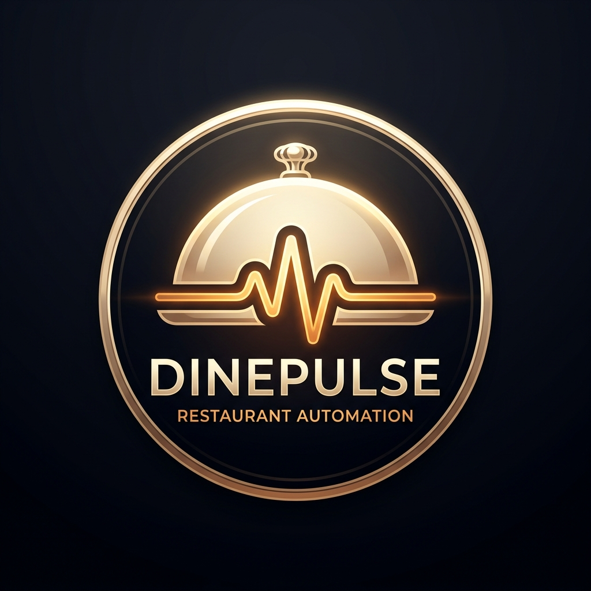

<div align="center">

  

  # DinePulse (by v4stay)

  **Next-Generation QR-Code Digital Menu, Contactless Ordering & Restaurant Automation System**

  [](https://react.dev/)
  [](https://vitejs.dev/)
  [](https://firebase.google.com/)
  [](https://razorpay.com/)
  [](LICENSE)

  [**Live Website**](https://taste.v4stay.com) • [**Features**](#-key-features) • [**Tech Stack**](#-tech-stack) • [**Getting Started**](#-getting-started) • [**QR Poster Generator**](#-8k-qr-standee-poster-generator)

</div>

---

## 📖 Overview

**DinePulse** (powered by **v4stay**) is an ultra-luxury, enterprise-grade digital menu and restaurant automation platform designed for modern fine-dining establishments, boutique hotels, cafes, cloud kitchens, and resort bars. 

Guests simply scan a table QR code on their smartphone to view a dynamic, high-definition digital menu, customize items, and place instant orders directly to the kitchen—**no app download required**.

---

## ✨ Key Features

### 📱 Guest Contactless Dining
- **No App Download**: Guests scan the table QR code to open the web menu instantly.
- **Dynamic Digital Menu**: Categories, dietary tags (🟢 Veg / 🔴 Non-Veg), descriptions, prices, and high-res imagery.
- **Real-Time Order Cart**: Instant tax calculation, special chef instructions, and table order tracking.

### 👨‍🍳 Kitchen Display System (KDS)
- **Live Real-Time Sync**: Instant WebSockets via Firebase Firestore when a guest places an order.
- **Audio Chime Alerts**: Loud notification chime alerting kitchen staff to new incoming orders.
- **Status Workflow**: `Pending` ➔ `Preparing` ➔ `Completed` status management.

### 🛎️ Staff & POS Management
- **Staff Security PIN**: Quick 4-digit PIN authentication for waiters and floor staff.
- **Order Printing**: One-click thermal receipt printing and kitchen ticket (KOT) generation.

### 👑 Restaurant Admin Dashboard
- **Menu Manager**: Add/edit categories, food items, prices, dietary tags, and out-of-stock toggles.
- **Table Manager**: Create tables and auto-generate unique table QR links.
- **Sales Analytics & Reports**: Revenue trends, order volume charts, and top-selling items using Recharts.
- **Store Settings**: Custom currency symbols, tax rates, UPI payment IDs, and restaurant branding.

### 🖼️ 8K Printable QR Standee Generator
- **HTML5 High-Definition Canvas Generator**: Built-in poster generator producing 8K printable table standees.
- **Ultra-Luxury Layout**: Royalty gold borders, custom restaurant branding, scanner badges (`100% Safe`, `Made in India`, `Paperless Eco-Friendly`).

### 💳 Automated Razorpay SaaS Subscriptions
- **Instant Plan Upgrade**: Direct integration with Razorpay Checkout for seamless subscription upgrades (Free ➔ Premium ₹14,999/yr).

---

## 🛠️ Tech Stack

| Component | Technology | Description |
| :--- | :--- | :--- |
| **Frontend Framework** | React 18 | Component-driven UI architecture |
| **Build Tool** | Vite 8 | Ultra-fast HMR and bundle optimization |
| **Routing** | React Router v6 | Client-side routing and protected routes |
| **Database & Auth** | Firebase Firestore & Auth | Real-time WebSocket subscriptions and secure auth |
| **Payment Gateway** | Razorpay Checkout SDK | Live merchant subscription automation |
| **Data Visualization** | Recharts | Responsive revenue and order volume analytics |
| **Icons & Styling** | Lucide React & Vanilla CSS | Obsidian Midnight & Champagne Gold design system |
| **SEO & Metadata** | React Helmet Async | Dynamic Open Graph tags, canonical URLs, JSON-LD schemas |

---

## 📁 Project Structure

```
taste-by-v4stay/
├── public/                     # Static assets, logos, favicons & sitemap
│   ├── logo.png                # DinePulse Champagne Gold emblem
│   ├── luxury-1.png            # High-res interior dining photography
│   ├── favicon.svg             # Gold cloche SVG favicon
│   └── sitemap.xml             # Search engine sitemap
├── src/
│   ├── components/             # Reusable UI components & thermal receipt templates
│   │   ├── ErrorBoundary.jsx   # Fallback error catcher
│   │   └── ReceiptTemplate.jsx # Printable receipt & KOT layout
│   ├── context/
│   │   └── AuthContext.jsx     # Firebase Auth context provider
│   ├── lib/
│   │   ├── firebase.js         # Firebase initialized app & Firestore export
│   │   ├── razorpay.js         # Dynamic Razorpay checkout helper
│   │   └── subscription.js     # SaaS plan calculation & features
│   ├── pages/                  # Page routes
│   │   ├── LandingPage.jsx     # Main SaaS marketing landing page
│   │   ├── AuthPage.jsx        # Login & Signup portal
│   │   ├── LegalPage.jsx       # Terms, Privacy, Cookies & Refund policies
│   │   ├── RestaurantSoftwarePage.jsx # SEO page for "restaurant software"
│   │   ├── FoodSoftwarePage.jsx       # SEO page for "food software"
│   │   ├── RestaurantAutomationPage.jsx # SEO page for "restaurant automation"
│   │   ├── admin/             # Admin Dashboard views
│   │   │   ├── Dashboard.jsx   # Analytics overview & sidebar layout
│   │   │   ├── MenuManager.jsx # Menu & item management
│   │   │   ├── TableManager.jsx# Table manager & 8K QR poster generator
│   │   │   ├── Analytics.jsx   # Financial charts & reports
│   │   │   └── Settings.jsx    # Store settings & Razorpay upgrade
│   │   ├── guest/
│   │   │   └── MenuView.jsx    # Guest digital QR menu view
│   │   ├── kitchen/
│   │   │   └── KitchenDisplay.jsx # Live Kitchen Display System (KDS)
│   │   └── staff/
│   │       ├── StaffLogin.jsx     # Staff PIN login
│   │       └── StaffDashboard.jsx # Waiter live order dashboard
│   ├── App.jsx                 # Main App routes declaration
│   ├── main.jsx                # Application entrypoint
│   └── index.css               # Global Luxury Obsidian & Gold design system
├── .env                        # Environment variables configuration
├── package.json                # Project dependencies & scripts
└── vite.config.js              # Vite configuration
```

---

## 🚀 Getting Started

### Prerequisites
- **Node.js** `v18.0.0` or higher
- **npm** `v9.0.0` or higher

### Installation

1. **Clone the Repository**:
   ```bash
   git clone https://github.com/virat709/taste-by-v4stay.git
   cd taste-by-v4stay
   ```

2. **Install Dependencies**:
   ```bash
   npm install
   ```

3. **Configure Environment Variables**:
   Create a `.env` file in the root directory:
   ```env
   VITE_RAZORPAY_KEY_ID=rzp_live_TFicYTXOl4wTZ1
   VITE_FIREBASE_API_KEY=your_firebase_api_key
   VITE_FIREBASE_AUTH_DOMAIN=your_project.firebaseapp.com
   VITE_FIREBASE_PROJECT_ID=your_project_id
   VITE_FIREBASE_STORAGE_BUCKET=your_project.appspot.com
   VITE_FIREBASE_MESSAGING_SENDER_ID=your_sender_id
   VITE_FIREBASE_APP_ID=your_app_id
   ```

4. **Run Local Development Server**:
   ```bash
   npm run dev
   ```
   Open **[http://localhost:5173](http://localhost:5173)** in your browser.

5. **Build for Production**:
   ```bash
   npm run build
   ```

---

## 🖨️ 8K QR Standee Poster Generator

DinePulse includes an in-browser HTML5 Canvas rendering engine inside `TableManager.jsx` that automatically generates print-ready 8K table standee posters.

### Poster Specifications:
- **Canvas Resolution**: `1600px × 2500px` (8K Retina rendering)
- **Border Theme**: Royal Gold Dual Frame
- **High-Contrast Scanner**: `360px × 360px` QR code box
- **Feature Badges**: `📱 Scan Code` • `📖 Explore Menu` • `🍛 Order Favorites`
- **Trust Badges**: `🛡️ 100% Safe` • `🇮🇳 Made in India` • `🍃 Paperless Eco-Friendly`

---

## 📄 License

Distributed under the **MIT License**. See `LICENSE` for more information.

---

<div align="center">
  <sub>Built with ❤️ by <strong>v4stay</strong>. Powering the future of luxury restaurant automation.</sub>
</div>
